<!-- ============================================================= -->
<!-- TOP BANNER (860px canvas with matching dark border & radius)  -->
<!-- ============================================================= -->
<h3><code>kaushal@github ~ $ ./banner.sh --creative-mode</code></h3>

 
 

<!-- animated contribution graph: real data, boxes reveal cell by cell
     (regenerated daily by .github/workflows/update-profile-art.yml) -->

<h3><code>kaushal@github ~ $ ./contributions.sh</code></h3>

 
 

<!-- ascii portrait (left) + streak/numbers card (right). both svgs are
     840x880 so equal widths give equal heights.
     portrait: python scripts/prep_photo.py <photo.png> && python scripts/make_ascii_svg.py
     stats:    python scripts/render_stats_svg.py (auto-refreshed daily) -->

<h3><code>kaushal@github ~ $ whoami</code></h3>

<table>
<tr>
<td valign="top"></td>
<td valign="top"></td>
</tr>
</table>

 
 

<!-- creative community building blocks: custom terminal window SVG generated by scripts/render_blocks_svg.py -->

<h3><code>kaushal@github ~ $ ./building-blocks.sh</code></h3>

 
 

<h3><code>kaushal@github ~ $ ./skills.sh</code></h3>

  

 
 

<h3><code>kaushal@github ~ $ ./links.sh</code></h3>

<b>Software Developer · Mobile & Web Builder · Tech Enthusiast</b>

 

