<!-- ============================================================= -->
<!-- TOP BANNER (Commented out per request)                        -->
<!-- ============================================================= -->
<!--
<h3><code>kaushal@github ~ $ ./banner.sh --creative-mode</code></h3>

  

-->

<!-- ============================================================= -->
<!-- 01. IDENTITY & HERO: whoami                                   -->
<!-- ============================================================= -->
<h1><code>kaushal@github ~ $ whoami</code></h1>

  <b>Kaushal Maran</b> 
  Software Developer · Mobile &amp; Web Builder · Tech Enthusiast

<!-- ascii portrait (left) + streak/numbers card (right). both svgs are 840x880 -->
<table align="center">
  <tr>
    <td valign="top">
      
    </td>
    <td valign="top">
      
    </td>
  </tr>
</table>

 

<!-- ============================================================= -->
<!-- 02. CORE ARCHITECTURE & FOCUS: building-blocks.sh             -->
<!-- ============================================================= -->
<h3><code>kaushal@github ~ $ ./building-blocks.sh</code></h3>

  

 

<!-- ============================================================= -->
<!-- 03. CONTRIBUTION ACTIVITY: contributions.sh                   -->
<!-- ============================================================= -->
<h3><code>kaushal@github ~ $ ./contributions.sh</code></h3>

  

 

<!-- ============================================================= -->
<!-- 04. TECH STACK & TOOLS: skills.sh                             -->
<!-- ============================================================= -->
<h3><code>kaushal@github ~ $ ./skills.sh</code></h3>

  

 

<!-- ============================================================= -->
<!-- 05. CONNECT & SOCIAL LINKS: connect.sh                        -->
<!-- ============================================================= -->
<h3><code>kaushal@github ~ $ ./connect.sh</code></h3>

  <i>Let's build something impactful together — open for mobile engineering, AI systems &amp; creative collaborations.</i>

  
  &nbsp;
  
  &nbsp;
  
  &nbsp;
  

 

  

