<!-- ============================================================= -->
<!-- TOP BANNER (Commented out per request)                        -->
<!-- ============================================================= -->
<!--
<h3><code>kaushal@github ~ $ ./banner.sh --creative-mode</code></h3>

  

-->

<!-- ============================================================= -->
<!-- 01. IDENTITY & LIVE GIT HERO: whoami                          -->
<!-- ============================================================= -->
<h1><code>kaushal@github ~ $ whoami</code></h1>

  <b>Kaushal Maran</b> 
  Software Developer · Mobile &amp; Web Builder · Tech Enthusiast

<!-- Live Git Telemetry & Status Ribbon -->

  
  &nbsp;
  
  &nbsp;
  
  &nbsp;
  

<!-- ascii portrait (left) + streak/numbers card (right). both svgs are 840x880 -->
<table align="center">
  <tr>
    <td valign="top">
      
    </td>
    <td valign="top">
      
    </td>
  </tr>
</table>

<!-- Interactive Terminal Inspector Dropdown -->

  

    <b>▶ <code>kaushal@github:~$ ./system-diagnostics.sh --verbose</code></b> <i>(Click to inspect live environment)</i>
  

   
  <pre style="background: #0d1117; border: 1px solid #30363d; border-radius: 8px; padding: 14px; color: #c9d1d9; font-size: 12px; line-height: 1.6; font-family: ui-monospace, monospace;">
<code># Kaushal Maran — System Diagnostics &amp; Telemetry
USER         = kaushalboii
PRIMARY_LANG = Python 3.11 · Swift 5.10 · Dart / Flutter · JavaScript
ACTIVE_STACK = SwiftUI · FastAPI · Docker · PostgreSQL · Firebase
CORE_DOMAINS = Native iOS Mobile Architectures · Autonomous Intelligent Agents · Scalable Systems
PRODUCTIVITY = 2,535+ Git contributions in 2026 · Daily streak automation active
HARDWARE     = Apple Silicon (macOS Sequoia) · Terminal Zsh · Neovim &amp; Xcode
STATUS       = Open for innovative engineering collaborations &amp; mobile/agent projects</code>
  </pre>

 

<!-- ============================================================= -->
<!-- 02. CORE ARCHITECTURE & FOCUS: building-blocks.sh             -->
<!-- ============================================================= -->
<h3><code>kaushal@github ~ $ ./building-blocks.sh</code></h3>

  

 

<!-- ============================================================= -->
<!-- 03. RETRO ARCADE & INTERACTIVE: arcade.sh                     -->
<!-- ============================================================= -->
<h3><code>kaushal@github ~ $ ./arcade.sh --play-pacman</code></h3>

  <i>Watch Pac-Man &amp; Ghosts actively play through live GitHub contribution squares!</i>

  <picture>
    <source media="(prefers-color-scheme: dark)" srcset="https://raw.githubusercontent.com/kaushalboii/kaushalboii/output/pacman-contribution-graph-dark.svg">
    <source media="(prefers-color-scheme: light)" srcset="https://raw.githubusercontent.com/kaushalboii/kaushalboii/output/pacman-contribution-graph.svg">
    
  </picture>

<!-- Interactive Click-To-Play Terminal Quest -->

  

    <b>🕹️ <code>kaushal@github:~$ ./start-quest.sh</code></b> <i>(Click to play interactive developer quest)</i>
  

   
  

    
👾 <b>WELCOME TO THE TERMINAL DUNGEON!</b> Choose your quest path:

    <ul>
      <li><a href="https://github.com/kaushalboii?tab=repositories" target="_blank"><b>[Option A]</b> 🚀 Inspect Kaushal's latest mobile &amp; agent repositories</a></li>
      <li><a href="https://www.linkedin.com/in/kaushal-maran-m-9572622b1" target="_blank"><b>[Option B]</b> 🤝 Connect on LinkedIn to discuss architecture &amp; ideas</a></li>
      <li><a href="mailto:kaushalmaran@gmail.com"><b>[Option C]</b> ✉️ Send a direct dispatch to Kaushal's inbox</a></li>
    </ul>
    
<i>Achievement Unlocked: +50 XP for exploring the interactive profile terminal!</i>

  

 

<!-- ============================================================= -->
<!-- 04. CONTRIBUTION ACTIVITY: contributions.sh                   -->
<!-- ============================================================= -->
<h3><code>kaushal@github ~ $ ./contributions.sh</code></h3>

  

 

<!-- ============================================================= -->
<!-- 05. TECH STACK & TOOLS: skills.sh                             -->
<!-- ============================================================= -->
<h3><code>kaushal@github ~ $ ./skills.sh</code></h3>

  

 

<!-- ============================================================= -->
<!-- 06. CONNECT & SOCIAL LINKS: connect.sh                        -->
<!-- ============================================================= -->
<h3><code>kaushal@github ~ $ ./connect.sh</code></h3>

  <i>Let's build something impactful together — open for mobile engineering, AI systems &amp; creative collaborations.</i>

  
  &nbsp;
  
  &nbsp;
  
  &nbsp;
  

 

  

